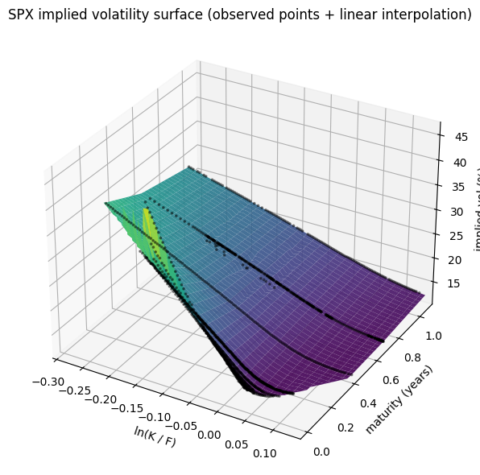
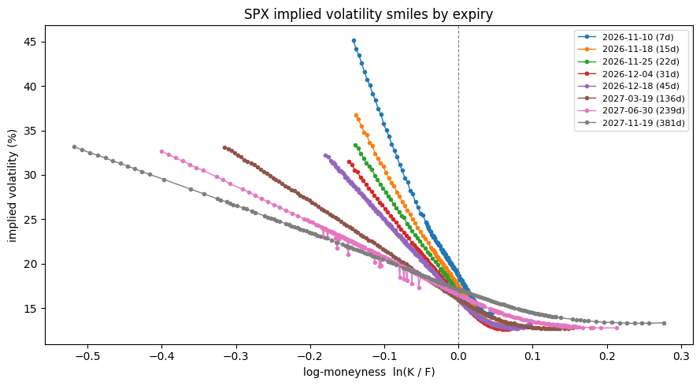

# Quantitative Finance Projects

**Jonathan Phung** · Master in Management (Market Finance), ESCP Business School · ex-Société Générale FIC Trading intern & ex-Pictet 
Product Sales 

Derivatives pricing, implied volatility and trade-idea projects in Python.

| Project | What it shows | Link |
|---|---|---|
| G10 FX Option Pricer | Interactive Python app: multi-leg FX options with a volatility smile, premium and Greeks | [Live app](https://jonathan-fx-pricer.streamlit.app) |
| SPX Implied Volatility Surface | Implied vol surface rebuilt from listed SPX option quotes | [Notebook](spx_implied_volatility_surface.ipynb) |
| Trade Idea #01 — Conditional Long Correlation *(in progress)* | Desk-style pitch: buying S&P 500 correlation (short dispersion) when dispersion is extreme, tested on full history | [Pitch](trade-ideas/01-long-correlation/) |

---

## 1. G10 FX Option Pricer

**[Open the live app](https://jonathan-fx-pricer.streamlit.app)**

Interactive Python app (Streamlit) to price vanilla FX option structures on nine G10 currency pairs: calls, puts, straddles, strangles, risk reversals and spreads, up to five editable legs.

- **Pricing:** Garman-Kohlhagen (Black-76 on the forward), premium discounted to today, foreign rate implied from the forward by covered interest parity
- **Volatility smile:** built from ATM, 25-delta and 10-delta risk reversals and butterflies, interpolated in log-moneyness
- **Outputs:** premium (base ccy and % of notional), spot delta, vega, gamma, P&L at expiry and the smile with your strikes

Code: [`fx_core.py`](fx_core.py) (pricing and smile) and [`app.py`](app.py) (interface). Run locally with `pip install -r requirements.txt` then `streamlit run app.py`.

*Limitations:* static market snapshot, quote-currency rate is an assumption, simplified smile construction (no full calibration, non premium-adjusted deltas).

## 2. SPX Implied Volatility Surface

Notebook: [`spx_implied_volatility_surface.ipynb`](spx_implied_volatility_surface.ipynb). It downloads a live SPX option chain (Yahoo Finance) or reads `Chain.csv` / `Meta.csv`.

Pipeline: liquidity filters, call/put matching by strike and expiry, forward estimation through put-call parity, out-of-the-money selection, Black-76 inversion, calendar and butterfly arbitrage checks.

*Limitations:* single snapshot, mid prices, flat interest rate, no dividend curve, arbitrage diagnosed but not repaired.

## 3. Trade Ideas

Desk-style pitches. Each one has a notebook that runs end to end in Google Colab on free data, and the notebook generates every level quoted in the pitch.

| # | Idea | Asset class | Status | Notebook |
|---|---|---|---|---|
| 01 | [Conditional long correlation — short S&P 500 dispersion](trade-ideas/01-long-correlation/) | Equity derivatives | In progress | [Open in Colab](https://colab.research.google.com/github/Jojolap1/quant-finance-projects/blob/main/trade-ideas/01-long-correlation/long_correlation_trade_idea.ipynb) |

---

**Tools:** Python (NumPy, pandas, SciPy, Matplotlib, Plotly, Streamlit), VBA

**Contact:** jonathan.phung@edu.escp.eu
