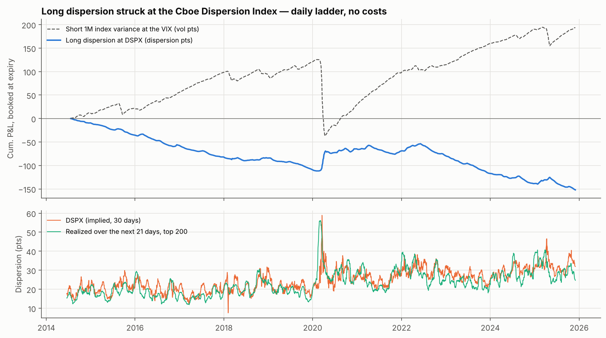

# Trade Idea #01 — S&P 500 volatility premium: the seller is paid, and survivorship bias hides the real cost of correlation

*Jonathan Phung · data as of 2026-11-10 · every figure generated by [`long_correlation_trade_idea.ipynb`](long_correlation_trade_idea.ipynb), none typed by hand · not investment advice*

> **In short.** Selling 1M S&P 500 variance at the VIX every day earned +21.2 vol pts a year since 2008, at the price of a -173.8 drawdown in a crash: the premium is on the seller's side. Survivorship bias hides the real cost of correlation: realized correlation averages 38.2 with the largest companies of each day, against 19.9 with today's names applied to the past. Long dispersion struck at the Cboe Dispersion Index returned -1.15 pts per tranche over 2014–2025, losing in 11 years out of 12: no premium there on this measure. A rule to stand aside when the VIX curve inverts cuts the drawdown to -111.6 but is not validated yet, so it is tracked live.

## 1. Finding 1 — the premium is on the seller's side
Buying 1M S&P 500 variance at the VIX every trading day since 2001-01-22 returned -649.9 vol pts in total, -25.24 a year (one tranche of 1/21 unit of vega notional a day, held to expiry, no costs). The buyer of insurance pays on average; the seller of the same ladder collects the mirror image and carries the crash.

**Selling the premium, with one rule to stand aside** (2008–2026; protocol 5, written before the run). Sell 1M S&P 500 variance at the VIX, one tranche a day, held to expiry. Switch: no new sale when, at the previous close, VIX3M/VIX was in the bottom 20% of its own past (544 days in 53 episodes, 12% of the time).

| Seller of 1M variance at the VIX | P&L per year (vol pts) | Max drawdown | P&L per year / max drawdown | Worst tranche | Time in market |
|---|---|---|---|---|---|
| Every day | +21.2 | -173.8 | 0.12 | -252.2 | 100% |
| **With the switch** | +22.9 | -111.6 | 0.21 | -252.2 | 88% |

| Criterion fixed in advance | Result on this run | Met on this run? |
|---|---|---|
| Max drawdown at least one third smaller | -173.8 → -111.6 (-36%) | yes |
| P&L per year / max drawdown higher | 0.12 → 0.21 | yes |
| Seller's P&L per tranche lower on OFF days than on any day (time-shift test) | -1.19 vs +1.80, p = 0.050 | yes |
| Still lower when any one OFF episode is left out | worst case +1.44 vs +1.80 | yes |

**Not retained**: the protocol allowed one run. It was made on data to 2026-11-09 and gave a time-shift p-value of 0.051 for a 5% bar, with 3 of 4 criteria met. The table above is this later run (data to 2026-11-10): it gives p = 0.050 and would pass on its own. A verdict that turns on one more day of data and on the random draws (a p-value from 2,000 shifts is known to about ±0.005) sits on the bar, not above it: the registered verdict stands, and the forward log is what can settle it. Selling on OFF days lost money in 4 of 53 episodes (average per episode +4.8 vol pts per tranche; ON days average +2.20). The switch does not avoid the first hit: the worst tranche (-252 vol pts) was sold on a day the switch allowed, before the curve inverted; what it removes is the selling that follows. The sample starts in 2008-07, when the percentile first exists. The every-day seller's premium is the stable result of this page; it comes with the drawdown shown in the table, and VIX² is not an executable strike (no bid-offer, no costs).

| Variants (reported, not used to decide) | P&L per year | Max drawdown | P&L per year / max drawdown | Worst tranche | Time in market |
|---|---|---|---|---|---|
| Threshold 10% | +25.0 | -114.0 | 0.22 | -252.2 | 95% |
| Threshold 30% | +21.1 | -99.7 | 0.21 | -252.2 | 81% |
| Switch read the same day | +23.2 | -104.7 | 0.22 | -252.2 | 88% |
| Open tranches closed at their mark on the first OFF day (no bid-offer: optimistic) | +21.4 | -37.5 | 0.57 | n/a | 88% |

| Stress window (seller's P&L, vol pts) | Every day | With the switch |
|---|---|---|
| US downgrade (Jul–Oct 2011) | -34.5 | -28.8 |
| China deval. (Aug 2015) | -28.6 | -28.3 |
| Volmageddon (Feb 2018) | -32.1 | -31.6 |
| Q4 2018 | -21.6 | -14.6 |
| COVID (Feb–Mar 2020) | -155.0 | -103.7 |
| 2022 bear market | +6.7 | -0.1 |
| Yen carry unwind (Jul–Aug 2024) | -24.8 | -19.5 |
| Tariff shock (Feb–Apr 2025) | -38.5 | -21.7 |

## 2. Finding 2 — survivorship bias hides the real cost of correlation
The usual free-data shortcut is to take today's 50 largest S&P 500 stocks and apply them to the past. Those names were smaller and less correlated then, so the shortcut understates past realized correlation and overstates what a buyer of correlation paid.

Measured instead on the 50 largest US companies *of each day* (CRSP, basket frozen on the entry day), over 2007-02-01 to 2025-12-31:

| | Today's names applied to the past | Names of each day (point-in-time) |
|---|---|---|
| Average 3M realized correlation | 19.9 | 38.2 |
| COR3M minus trailing realized correlation (pts) | 22.1 | 3.8 |
| Buying 3M correlation at COR3M on any day (pts per trade) | -21.5 | -4.2 |

The buyer of correlation still pays on average, but most of the cost shown by the shortcut is an artefact of the universe. Any backtest of dispersion or correlation trades built on today's index members carries this bias.

## 3. Long dispersion, measured with the Cboe Dispersion Index
Long dispersion is the seller's side of correlation: long single-stock variance, short index variance. The Cboe Dispersion Index (DSPX) gives its strike, since DSPX² is the weighted average 30-day expected variance of the stocks minus VIX². One tranche a day from 2014-06-19 to 2025-12-01 (2,880 days), held 21 trading days, against the realized dispersion of the 200 largest US companies of the entry day (protocol 6, written before the data was downloaded). DSPX averaged 24.7 and realized dispersion 23.2.

| Daily ladder, no costs | P&L per tranche | P&L per year | Max drawdown | P&L per year / max drawdown | Worst tranche | Positive tranches |
|---|---|---|---|---|---|---|
| **Long dispersion** (dispersion pts) | -1.15 | -13.4 | -152.0 | -0.09 | -12.5 | 27% |
| Short 1M index variance at the VIX, same days (vol pts) | +1.46 | +17.1 | -162.6 | 0.10 | -252.2 | 82% |

| Criterion fixed in advance | Result | Met? |
|---|---|---|
| Average P&L per tranche positive, 95% interval excluding zero | -1.15 (-1.93 to -0.24) | **no** |
| Also positive with the 50 largest companies | -2.08 | **no** |
| Still positive leaving out any one calendar year | worst case -1.64 (without 2020) | **no** |

**Not retained**: the average is negative. On this measure, long dispersion paid more for single-stock variance than the stocks delivered. It lost in 11 calendar years out of 12. It behaves like the mirror image of short index variance (correlation of tranche P&L -0.65): it bleeds in calm markets and pays in a crash. The average rises with the breadth of the basket (-2.08 with 50 names, -1.15 with 200), so part of the shortfall may come from the proxy basket. This is not the same object as the COR3M figure of section 2: COR3M uses at-the-money volatilities over 3 months on 50 names, DSPX uses variance strikes over 30 days, which include the price of each stock's tails. This page does not establish which is closer to a tradable price. Read with care: DSPX is back-tested before its launch in September 2023, it is built from mid-quotes and is not an executable strike, and the realized basket leaves out the smaller S&P 500 names, which should understate realized dispersion.

| Stress window | Long dispersion | Short index variance |
|---|---|---|
| China deval. (Aug 2015) | -0.5 | -0.8 |
| Volmageddon (Feb 2018) | -0.6 | -2.0 |
| Q4 2018 | +4.2 | -7.0 |
| COVID (Feb–Mar 2020) | +15.4 | -99.0 |
| 2022 bear market | -3.9 | +11.1 |
| Yen carry unwind (Jul–Aug 2024) | +1.6 | -0.2 |
| Tariff shock (Feb–Apr 2025) | +3.1 | -1.8 |

## 4. What is not established
* **When the seller should stand aside.** The term-structure rule of section 1 meets 3 of the 4 criteria fixed in advance (time-shift p = 0.051 for a 5% bar) and was found on the same years. It is not validated. It is logged every trading day in `forward_log.csv` and will be judged once on new data.
* **Timing rules for the buyer.** Several were tested, including a search over 242 candidates with a holdout and a test on the euro area; none is retained. Protocols, written before each run, and results are in [`PREREGISTRATION.md`](PREREGISTRATION.md).
* **An executable long-dispersion backtest.** Section 3 uses an index as the strike. A tradable version needs the history of single-stock implied volatilities, name by name, which is not public.

## 5. Structure and risks
* **Trade:** short 1M S&P 500 variance (variance swap, or delta-hedged straddles as a proxy), rolled as a daily ladder.
* **Sizing:** on the loss, not on the average gain. Per unit of vega notional, the every-day seller's maximum drawdown was -173.8 vol pts and its worst single tranche -252.2 vol pts, against +21.2 a year of premium.
* **Main risk:** a crash arrives while the book is short. The worst tranche was sold before the VIX curve inverted, so the rule of section 1 does not avoid the first hit; it only stops the selling that follows.
* **Other risks:** losses are marked long before expiry; a real variance strike trades below VIX² on the bid; margin calls can force an exit at the worst time.

## 6. Method and limitations
* **Variance P&L:** (realized variance over the next 21 trading days − VIX²) / (2 × VIX), in vol points per unit of vega notional; zero-mean realized variance, 252-day annualization. VIX² stands in for the variance strike, with no convexity adjustment, no bid-offer and no costs.
* **Correlation P&L:** realized correlation of the basket over the next 63 trading days minus COR3M. COR3M is an index, not an executable price.
* **Dispersion P&L:** (realized dispersion² − DSPX²) / (2 × DSPX), where realized dispersion² is the cap-weighted average of the stocks' realized variances minus the realized variance of the index over the next 21 trading days. DSPX is back-tested before September 2023.
* **Point-in-time basket:** the 50 largest US companies by CRSP capitalization, not the exact Cboe basket (no float adjustment, no index-membership test); sample ends 2025-12-31. The CRSP file is licensed and is not in this repository; without it the notebook runs and skips this part.
* **Seller's test:** the rule to stand aside was found on the same years, so its backtest is in-sample. The protocol allowed one run; its verdict is fixed in the notebook's configuration and later runs report next to it.
* **Sample size:** crises are few. Every figure that depends on them rests on a handful of episodes.

## 7. Conclusion
**1. The premium is on the seller's side.** Selling 1M S&P 500 variance at the VIX every day earned +21.2 vol pts a year since 2008. The price is the crash: a maximum drawdown of -173.8 vol pts.

**2. Survivorship bias hides the real cost of correlation.** Realized correlation averages 38.2 with the largest companies of each day, against 19.9 with today's names applied to the past. Buying correlation on any day then costs 4.2 pts per trade instead of 21.5.

**3. When to stand aside is not settled.** Not selling when the VIX curve inverts cut the drawdown to -111.6 and met 3 of the 4 criteria fixed in advance (it missed one, with p = 0.051 for a 5% bar). The rule is not validated: it is logged every trading day and will be judged on new data.

**4. Long dispersion, the seller's side of correlation, lost on average.** Struck at the Cboe Dispersion Index over 2014–2025, it returned -1.15 dispersion pts per tranche (95% interval -1.93 to -0.24), -13.4 a year with a maximum drawdown of -152.0. It lost in 11 years out of 12 and paid in a crash: closer to insurance than to a premium. The index is back-tested before 2023, is not an executable price, and the realized basket is a proxy.

**5. What I would do.** Treat short index variance as a premium to be sized on its worst drawdown, not on its average gain; use point-in-time baskets for any correlation backtest; and keep the term-structure rule as a candidate until the forward test is in.
