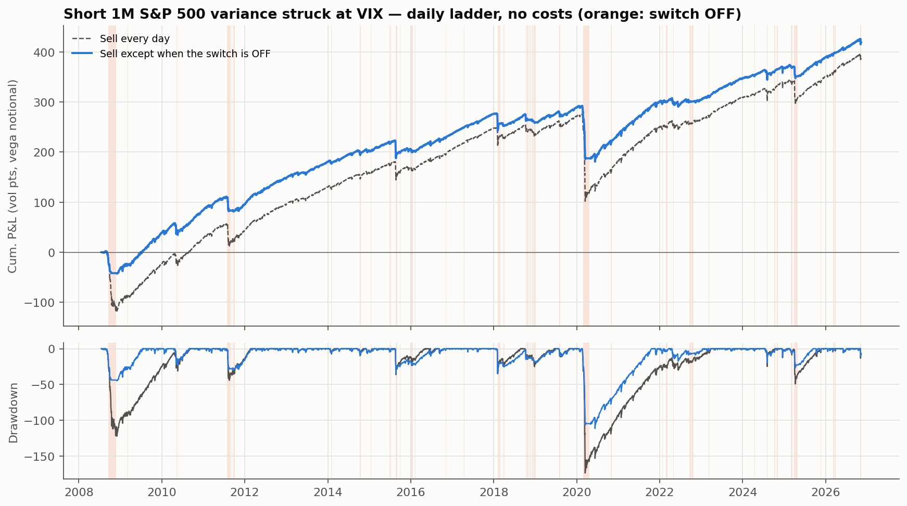

# Trade Idea #01 — S&P 500 correlation: I set out to buy it, the data says sell it and know when to stop

*Jonathan Phung · data as of 2026-11-10 · every figure generated by [`long_correlation_trade_idea.ipynb`](long_correlation_trade_idea.ipynb), none typed by hand · not investment advice*

> **Status: tests done, one forward test running.** The original idea (buy correlation when dispersion is extreme) is not supported as a timing rule. Five follow-up protocols were written before their runs ([`PREREGISTRATION.md`](PREREGISTRATION.md)); the term-structure rule is logged every trading day in `forward_log.csv`.

> **Rule status on 2026-11-10: SIGNAL ON — S1-sectors conditions met today** (S1-stocks: OFF · S0 high VIX: OFF)
>
> **Does 25+ years of data back the thesis? INCONCLUSIVE on 2001–2026: after S1-sectors days a ≥10% sell-off within 3M was 1.36× as frequent as on a random day (below the 1.5× threshold set in advance); buying S&P 500 variance at the VIX lost less than on a random day (-1.48 vs -2.12 vol pts per trade). By episode: 7 of 30 against a base rate of 16% (one-sided p = 0.21; 95% interval for the lift 0.72× to 2.51×; power of this sample to detect 1.5×: 30%). Variance lost less after the signal, but the gap is not statistically distinguishable from zero (95% interval -1.37 to +2.87 vol pts).**
>
> **Where the study ended up:** selling 1M variance at the VIX every day earned +21.2 vol pts a year since 2008, with a maximum drawdown of -173.8; standing aside when the VIX curve inverts took that drawdown to -111.6 and meets 3 of the 4 criteria fixed in advance (failed: time-shift test), so the rule is not validated and when to stop is still the open question.

**Bottom line (S1-sectors vs a random day, same period):**
* S&P 500 falls of 10% or more within 3M: 22% vs 16% (1.36×; threshold fixed in advance: 1.5×; 95% interval 0.72× to 2.51×, power 30%).
* Correlation spikes of +15 pts within 3M: 23% vs 12%.
* Sell-offs counted only from days within 5% of the 1-year high: 9% vs 9%.
* Average P&L per trade of buying 3M correlation at COR3M, point-in-time basket: 2.4 vs -4.2 corr pts (-2.2 on days with the same COR3M level; signal minus base, 95% interval 1.2 to 12.9). With today's names applied to the past: -6.2 vs -21.5, a survivorship artefact.
* Buying 1M variance at the VIX: -1.48 vs -2.12 vol pts (-2.22 at the same VIX level; 95% interval of the gap -1.37 to 2.87).
* The other side: selling 1M variance at the VIX every day earned +21.2 vol pts a year since 2008, with a maximum drawdown of -173.8; standing aside when the VIX curve inverts took that drawdown to -111.6 and meets 3 of the 4 criteria fixed in advance (failed: time-shift test), so the rule is not validated and when to stop is still the open question.
* Naive high-VIX rule (S0), for comparison: correlation spikes 3% vs 6%, variance P&L -3.41 vs -2.56 vol pts.

## 1. Thesis
Sometimes single stocks move a lot while the index stays calm, because they move in different directions. Dispersion is then extreme and correlation is low. My view is that this state does not last: when a macro shock hits, everything falls together and correlation spikes. Buying correlation in that state means buying crash insurance while it is cheap. The trade is short dispersion: long index vol, short single-stock vol.

**What the data said instead.** The signal does not forecast sell-offs, and buying correlation or variance loses on average: the premium sits on the seller's side. The pitch therefore turns around. I thought the trade was to buy correlation; the data says to sell it and to know when to stop. Sections 3 and 4 show both halves: why the long side fails, and what the short side earns and risks.

The idea is tested as a rule fixed in advance, not by picking crisis dates. The rule uses only data available on each date, counts false alarms, and compares each signal with a random day of the same period and with a naive "high VIX" rule.

## 2. The signal
* **S1-sectors (primary, since 2001-01-22):** the 1M gap between average sector vol and basket vol, for the 9 original sector SPDR ETFs, is above the 80th percentile of its own history, **and** 1M sector correlation is below the 33rd percentile. These are the same 9 investable ETFs since 1998, so there is no survivorship bias; their content did change (real estate left XLF, communication names left XLK and XLY).
* **S1-stocks (robustness, since 2006-09-18):** the same rule on today's top-50 S&P 500 stocks. This matches the COR3M basket but applies today's names to the past.
* **S1-stocks, point-in-time (since 2007-02-01, to 2025-12-31):** the same rule on the 50 largest US companies *of each day* (CRSP), with the basket frozen on the entry day to measure what follows. This removes the survivorship bias of the line above.
* **S0 (naive benchmark, since 1991-12-30):** VIX is above the 80th percentile of its own history.
* **Today:**
  * Sector dispersion is 10.2 vol pts (percentile 95%), with sector correlation of 27.3 (percentile 11%).
  * Stock dispersion is 22.5 vol pts (percentile 94%), with stock correlation of 19.1 over 1M and 13.1 over 3M (index-based; 18.9 over 3M measured on the basket itself).
  * COR3M is 13.8 (percentile 5% since 2006-01-03). VIX is 19.5 (percentile 60%) and VIX3M is 20.6.

## 3. Evidence: what happened next, vs a random day of the same period
| Signal | Days ON | Episodes | P(S&P 500 −10% within 3M): signal vs base | P(corr +15 pts): signal vs base | Avg P&L buying 1M variance at VIX (vol pts): signal vs base |
|---|---|---|---|---|---|
| **S1-sectors** | 684 | 30 | **22% vs 16%** (1.36×) | 23% vs 12% | -1.48 vs -2.12 |
| S1-stocks | 394 | 34 | 12% vs 15% (0.76×) | 13% vs 11% | -1.46 vs -1.78 |
| S1-stocks, point-in-time | 1403 | 43 | 11% vs 16% (0.65×) | 15% vs 14% | -0.95 vs -1.67 |
| S0 high VIX | 2035 | 44 | 19% vs 14% (1.37×) | 3% vs 6% | -3.41 vs -2.56 |

There were 30 S1-sectors episodes. 7 were followed by a sell-off of at least 10% within 3M, and 22 were false alarms, with neither a sell-off nor a correlation spike.

**What the point-in-time universe changes.** Over the common sample, 3M realized correlation averages 38.2 with the names of each day against 19.9 with today's names applied to the past, so COR3M minus trailing realized correlation is 3.8 pts instead of 22.1. Buying 3M correlation at COR3M then returns -2.2 pts per trade after the signal against -4.3 on a random day (-2.0 on days with the same COR3M level).

**Reference crises** (descriptive only; not used to build the rule). A signal that was ON before the peak only helps if the trade bought then was still alive and paid: the P&L column shows what those entries earned.

| Crisis (S&P 500 peak) | S1-sectors days ON (63d before) | S1-stocks | S0 high VIX | Avg P&L of those S1-sectors entries: variance (vol pts) / correlation (corr pts) | Sector corr 1M at peak → max next 3M | S&P 500 worst DD next 3M |
|---|---|---|---|---|---|---|
| Dot-com 2000 (2000-03-24) | n/a | n/a | 33 | n/a / n/a | 48.5 → 49.8 | -11.2% |
| GFC 2007 (2007-10-09) | 0 | 0 | 21 | n/a / n/a | 73.1 → 76.1 | -11.2% |
| COVID 2020 (2020-02-19) | 8 | 0 | 0 | -3.70 / -12.2 | 57.1 → 93.8 | -33.9% |
| Inflation & rates 2022 (2022-01-03) | 8 | 14 | 6 | 1.39 / -6.5 | 50.5 → 52.4 | -13.0% |
| Yen carry 2024 (2024-07-16) | 15 | 39 | 0 | 6.43 / 8.3 | 20.5 → 69.6 | -8.5% |
| Tariffs 2025 (2025-02-19) | 40 | 23 | 1 | 0.40 / 10.2 | 22.2 → 87.4 | -18.9% |

**How reliable is this?** Daily outcomes overlap, so the honest sample is the number of episodes. The table adds an episode-level test, a comparison with days at the same level of VIX / COR3M / realized correlation (low correlation mean-reverts and is cheap whatever the signal says), a time-shift test and a block bootstrap.

| Check | S1-sectors | S1-stocks (today's names) | S1-stocks (point-in-time) |
|---|---|---|---|
| Episodes followed by a sell-off (daily base rate) | 7 of 30 (16%) | 6 of 34 (15%) | 7 of 43 (16%) |
| One-sided p-value of that count | 0.21 | 0.43 | 0.56 |
| 95% interval for the lift | 0.72× to 2.51× | 0.54× to 2.17× | 0.50× to 1.85× |
| Power to detect a 1.5× lift | 30% | 25% | 35% |
| Sell-offs starting near the 1-year high: signal vs base | 9% vs 9% (520 days) | 11% vs 10% (377 days) | 10% vs 11% (1269 days) |
| Shift-test p: sell-off / variance P&L / correlation P&L | 0.16 / 0.28 / 0.00 | 0.75 / 0.37 / 0.00 | 0.93 / 0.25 / 0.19 |
| Variance P&L, signal minus base, 95% interval (vol pts) | -1.37 to +2.87 | -2.01 to +2.27 | -1.03 to +3.21 |
| Correlation P&L, signal minus base, 95% interval (corr pts) | +10.3 to +20.1 | +6.5 to +17.1 | -0.7 to +4.4 |
| Variance P&L: signal vs days with the same VIX level | -1.48 vs -2.22 | -1.46 vs -1.52 | -0.95 vs -1.44 |
| Correlation P&L: signal vs days with the same COR3M level | -6.2 vs -13.1 | -9.0 vs -12.3 | -2.2 vs -2.0 |
| Correlation spikes: signal vs days with the same realized correlation | 23% vs 24% | 13% vs 14% | 15% vs 18% |
| Correlation P&L with basket-based realized correlation: signal vs base | 9.0 vs -5.3 | 7.5 vs -5.2 | 3.5 vs -4.4 |
| Correlation P&L per episode: mean (range leaving one episode out) | -12.4 (-13.6 to -11.3), 4 of 29 positive | -15.1 (-16.3 to -14.0), 5 of 34 positive | -6.3 (-7.4 to -5.7), 10 of 43 positive |
| Sell-off episodes where buying correlation made money | 2 of 6 | 2 of 6 | 6 of 7 |
| **S1-sectors entries, correlation P&L on the point-in-time basket**: signal vs base vs same COR3M level | 2.4 vs -4.2 vs -2.2; signal minus base 95% interval +1.2 to +12.9, shift-test p 0.02; leaving one episode out -0.7 to +3.7; per episode: mean -0.6, median -3.4, 8 of 29 positive | | |

**Looking for a better signal, with a holdout.** A declared family of 242 candidates (11 indicators, each high or low, alone or in pairs) was scored on 2006–2016 only; 98 had at least 100 days and 8 episodes. The best one, **COR3M high AND VIX3M/VIX low**, returned +8.0 pts per trade there against -8.6 on days with the same COR3M level (120 days, 8 episodes). Tested once on the years after 2016: -5.1 vs -11.6 at the same COR3M level and -3.1 on any day (38 days, 2 episodes), shift-test p = 0.53. **It is not retained**: it fired in only 2 episodes after the split, too few to judge. Of the ten best candidates, 10 keep a positive edge after the split and 'VIX3M/VIX low' appears in 8 of them: a lead for a test on fresh data, not a result. The validation years were not used to choose it, but they had been looked at for the earlier signals of this page.

| Ten best candidates of the discovery period | Days / episodes | Edge vs same COR3M level | Validation days / episodes | Validation edge (not a test) |
|---|---|---|---|---|
| COR3M high AND VIX3M/VIX low | 120 / 8 | +16.6 | 38 / 2 | +6.5 |
| sector correlation high AND VIX3M/VIX low | 158 / 16 | +12.1 | 116 / 10 | +2.0 |
| VIX high AND VIX3M/VIX low | 154 / 12 | +13.8 | 164 / 21 | +2.4 |
| stock dispersion low AND VIX3M/VIX low | 103 / 12 | +11.2 | 32 / 4 | +2.5 |
| stock correlation high AND VIX3M/VIX low | 146 / 9 | +13.8 | 78 / 7 | +1.4 |
| VIX3M/VIX low AND credit spread 1M change high | 146 / 14 | +12.7 | 160 / 13 | +6.6 |
| VIX3M/VIX low AND S&P 500 1M return low | 163 / 16 | +11.3 | 205 / 17 | +5.3 |
| VIX3M/VIX low | 210 / 24 | +9.1 | 300 / 24 | +2.6 |
| VIX high AND S&P 500 1M return low | 273 / 15 | +9.2 | 203 / 14 | +4.4 |
| credit spread 1M change high AND S&P 500 1M return low | 285 / 21 | +8.4 | 216 / 15 | +6.5 |

**The same lead on the euro area** (public STOXX files, 2000–2016; one run, protocol written first). Rule: VSTOXX 3-month sub-index over VSTOXX in the bottom 20% of its own past. Buying 1M variance at the VSTOXX returned +1.37 vol pts per trade on the 233 signal days (41 episodes), against -2.24 on any day and -2.81 at the same VSTOXX level (shift-test p = 0.007). Leaving out one episode, the average can fall to -3.0; per episode the average is -3.8 and 7 of 41 episodes are positive. **Not retained**: the day-weighted average is carried by very few episodes, the profile of crash insurance bought late rather than of a timing signal. This is a variance trade, not a correlation trade, and the sample overlaps the discovery years of the US search.

The follow-up tests are recorded in [`PREREGISTRATION.md`](PREREGISTRATION.md) with their protocols written first: three candidates fixed in advance and a euro-area test of the term-structure lead, none retained, the seller's test of section 4, and a forward test that is still running.

## 4. Backtests (daily ladders, approximate mark-to-market, no costs)
**Long 1M S&P 500 variance at the VIX, over 25.7 years.** This is the crash-payoff leg of the trade.

| Strategy | From | Years | Total P&L (vol pts) | P&L/yr | Max drawdown | Time in market | P&L per year invested |
|---|---|---|---|---|---|---|---|
| S1-sectors ON | 2001-01-24 | 25.7 | -47.5 | -1.85 | -88.8 | 11% | -16.05 |
| S1-stocks ON | 2006-10-23 | 20.0 | -35.3 | -1.77 | -47.0 | 9% | -20.71 |
| S0 high VIX ON | 1994-04-05 | 32.6 | -335.2 | -10.29 | -335.2 | 25% | -41.47 |
| Every day (benchmark) | 2001-01-22 | 25.8 | -649.9 | -25.24 | -662.7 | 100% | -25.24 |

| Window | S1-sectors (vol pts) | S0 high VIX | Every day |
|---|---|---|---|
| Dot-com bust (2000–02) | n/a | -33.9 | n/a |
| 9/11 (Sep 2001) | 0.0 | 4.6 | 10.1 |
| GFC (Oct 2007–Mar 2009) | 32.6 | 41.8 | 70.0 |
| US downgrade (Jul–Oct 2011) | 0.0 | -0.4 | 34.5 |
| China deval. (Aug 2015) | 0.0 | -0.2 | 28.6 |
| Volmageddon (Feb 2018) | 0.0 | 0.6 | 32.1 |
| Q4 2018 | 4.6 | 1.0 | 21.6 |
| COVID (Feb–Mar 2020) | 0.0 | 47.8 | 155.0 |
| 2022 bear market | 1.9 | -15.3 | -6.7 |
| Yen carry unwind (Jul–Aug 2024) | 24.4 | 0.0 | 24.8 |
| Tariff shock (Feb–Apr 2025) | 7.5 | 3.1 | 38.5 |

**The other side: selling the premium, with one rule to stand aside** (2008–2026; protocol 5, written before the run). Sell 1M S&P 500 variance at the VIX, one tranche a day, held to expiry. Switch: no new sale when, at the previous close, VIX3M/VIX was in the bottom 20% of its own past (544 days in 53 episodes, 12% of the time).

| Seller of 1M variance at the VIX | P&L per year (vol pts) | Max drawdown | P&L per year / max drawdown | Worst tranche | Time in market |
|---|---|---|---|---|---|
| Every day | +21.2 | -173.8 | 0.12 | -252.2 | 100% |
| **With the switch** | +22.9 | -111.6 | 0.21 | -252.2 | 88% |

| Criterion fixed in advance | Result on this run | Met on this run? |
|---|---|---|
| Max drawdown at least one third smaller | -173.8 → -111.6 (-36%) | yes |
| P&L per year / max drawdown higher | 0.12 → 0.21 | yes |
| Seller's P&L per tranche lower on OFF days than on any day (time-shift test) | -1.19 vs +1.80, p = 0.050 | yes |
| Still lower when any one OFF episode is left out | worst case +1.44 vs +1.80 | yes |

**Not retained**: the protocol allowed one run. It was made on data to 2026-11-09 and gave a time-shift p-value of 0.051 for a 5% bar, with 3 of 4 criteria met. The table above is this later run (data to 2026-11-10): it gives p = 0.050 and would pass on its own. A verdict that turns on one more day of data and on the random draws (a p-value from 2,000 shifts is known to about ±0.005) sits on the bar, not above it: the registered verdict stands, and the forward log is what can settle it. Selling on OFF days lost money in 4 of 53 episodes (average per episode +4.8 vol pts per tranche; ON days average +2.20). The switch does not avoid the first hit: the worst tranche (-252 vol pts) was sold on a day the switch allowed, before the curve inverted; what it removes is the selling that follows. The sample starts in 2008-07, when the percentile first exists. The every-day seller's premium is the stable result of this page; it comes with the drawdown shown in the table, and VIX² is not an executable strike (no bid-offer, no costs).

| Variants (reported, not used to decide) | P&L per year | Max drawdown | P&L per year / max drawdown | Worst tranche | Time in market |
|---|---|---|---|---|---|
| Threshold 10% | +25.0 | -114.0 | 0.22 | -252.2 | 95% |
| Threshold 30% | +21.1 | -99.7 | 0.21 | -252.2 | 81% |
| Switch read the same day | +23.2 | -104.7 | 0.22 | -252.2 | 88% |
| Open tranches closed at their mark on the first OFF day (no bid-offer: optimistic) | +21.4 | -37.5 | 0.57 | n/a | 88% |

| Stress window (seller's P&L, vol pts) | Every day | With the switch |
|---|---|---|
| US downgrade (Jul–Oct 2011) | -34.5 | -28.8 |
| China deval. (Aug 2015) | -28.6 | -28.3 |
| Volmageddon (Feb 2018) | -32.1 | -31.6 |
| Q4 2018 | -21.6 | -14.6 |
| COVID (Feb–Mar 2020) | -155.0 | -103.7 |
| 2022 bear market | +6.7 | -0.1 |
| Yen carry unwind (Jul–Aug 2024) | -24.8 | -19.5 |
| Tariff shock (Feb–Apr 2025) | -38.5 | -21.7 |

## 5. Structure
*The structure below is the original long-correlation trade. The seller's side is its mirror image: short SPX variance or straddles alone (the leg tested in section 4), or long dispersion (short index vol, long single-stock vol), which sells correlation without the outright short-vol exposure but could not be backtested without single-stock implied volatilities.*

* **Long** 3M SPX ATM straddles (or an SPX variance swap). **Short** 3M ATM straddles on the 25 largest names (52% of index weight). Delta-hedge daily.
* **Theta-neutral:** component vega = **0.46 × index vega**. Per $100k of index vega, a 1-point rise in implied correlation gains ≈ **$34,563**.
* Today's snapshot: SPX 3M ATM vol 15.9%, average top-50 3M ATM vol 35.5%, implied correlation (own calculation) 15.4.
* **Carry:** ≈ -0.7 correlation pts per 3M at today's levels (negative = the insurance premium).
* **Cleaner alternative:** SPX put spreads or VIX calls, which have the same crash payoff without gap risk on short single-stock options.

## 6. Risks and exit
* **Risks:**
  1. No crisis arrives, so you pay carry and absorb false alarms.
  2. Gaps on the short single-stock legs (earnings, news): avoid names reporting during the option's life.
  3. Single-stock vol rises without correlation rising.
  4. Correlation spikes revert fast, so the gain is lost if not monetized.
  5. On the seller's side the risk is the opposite and it is larger: the loss in a crash is several years of premium (see the drawdown and worst tranche in section 4).
* **Take profit:** when COR3M reaches its historical 80th percentile (54.8), or when the VIX curve inverts and then normalizes.
* **Time stop:** hold to the 3M expiry and do not roll unless S1 is still ON.
* **Invalidation:** dispersion returns below its median without correlation rising.

## 7. Limitations
* **Small sample:** few independent episodes, so the percentages are indicative rather than statistically significant.
* **Sector correlation:** the long-history signal uses sector correlation, which is not single-stock correlation.
* **Backtest A:** it covers only the long-index-vol leg, and treats VIX² as the variance strike with no convexity adjustment.
* **Correlation P&L:** COR3M is used as the strike, but it is an index, not an executable price.
* **Seller's test:** the switch was found on the same years, so its backtest is in-sample; VIX² is not an executable strike and the seller gets the bid; only the index-variance leg is tested.
* **Not modelled anywhere:** short single-stock gamma and transaction costs.
* **Measure of realized correlation:** index-based (the COR3M convention) and basket-based measures differ by many points and can flip the sign of the correlation P&L. The reference-crisis table still uses today's names in the past; the point-in-time rows are the ones to trust.
* **Point-in-time basket:** the 50 largest US companies by CRSP capitalization, not the exact Cboe basket (no float adjustment, no index-membership test); sample ends 2025-12-31.

## 8. Conclusion
**1. Forecasting power.** After S1-sectors days, the S&P 500 fell 10% or more within 3M in 22% of cases, against 16% on a random day (1.36×, versus the 1.5× bar fixed in advance). 7 of 30 episodes were followed by such a sell-off and 22 were false alarms. With so few episodes the test cannot separate 1.5× from no effect at all (one-sided p = 0.21, 95% interval for the lift 0.72× to 2.51×, power 30%): there is no evidence that the signal forecasts crashes. Counting only days when the S&P 500 is within 5% of its 1-year high, the rates are 9% after the signal and 9% on any such day: the apparent lift comes from days already inside a drawdown.

**2. Cost of the insurance.** Measured on the point-in-time basket (the 50 largest companies of each day, frozen at entry), buying 3M correlation at COR3M after the signal returned +2.4 pts per trade, against -4.2 on a random day and -2.2 on days with the same COR3M level (signal minus random day, 95% interval +1.2 to +12.9). The signal adds something beyond 'COR3M is low'. With today's names applied to the past the same figures are -6.2 vs -21.5: most of that apparent cost, and of the apparent saving, is survivorship bias (realized correlation averages 38.2 point-in-time against 19.9). Measured on the basket itself instead of through the index, the point-in-time figures are 9.8 vs -4.6: same direction, but the size depends heavily on the measure. Robustness: leaving out any one of the 29 episodes, the signal-day average stays between -0.7 and 3.7 pts, above the random-day figure each time; but averaged per episode rather than per day it is -0.6 (median -3.4), with 8 of 29 episodes positive (basket-based: 5.6, 17 of 29). The saving against a random day survives; a positive P&L rests on a few sell-off episodes. Several outcomes were examined: multiplying the index-based p-value (0.02) by five tests gives 0.10. Correlation spikes of +15 pts followed 23% of signal days against 12% of random days, and 24% of days with equally low correlation. Buying variance at the VIX: -1.48 after the signal vs -2.12 on a random day and -2.22 at the same VIX level (signal minus random day, 95% interval -1.37 to +2.87).

**3. The naive rule.** After high-VIX days, correlation spikes followed 3% of days (random day: 6%) and buying variance at the VIX returned -3.41 vol pts per trade (random day: -2.56). High volatility arrives with the crisis, when insurance is already expensive: it is the wrong moment to buy correlation.

**4. The other side.** If the buyer pays on average, the seller is paid. Selling 1M variance at the VIX every day earned +21.2 vol pts a year since 2008, with a maximum drawdown of -173.8 vol pts: a premium for carrying the crash. With the switch (no sale when VIX3M/VIX was in the bottom 20% of its past the day before): +22.9 a year, maximum drawdown -111.6. On the days the switch is OFF the seller's tranche averaged -1.19 vol pts against +1.80 on any day (time-shift p = 0.051 on the single registered run; 0.050 on this later run, which does not change the verdict), and selling lost money in 4 of the 53 OFF episodes. 3 of the four criteria fixed in advance are met (failed: time-shift test): the switch is **not retained**. The premium is there; a validated rule to step out of the way is not, and the forward log is what can settle it.

**5. Today (2026-11-10).** Rule status: SIGNAL ON — S1-sectors conditions met today. Sector dispersion is at percentile 95% of its history, sector correlation at percentile 11%, COR3M at 13.8 (percentile 5%). Carry of a long-correlation position if nothing happens: about -0.7 correlation pts per 3M with index-based realized correlation, 5.1 with basket-based.

**6. Recommendation.** **I set out to buy correlation; the data says to sell it, and to know when to stop.** The signal does not forecast sell-offs and the buyer of correlation or variance pays on average, so the trade to study is the seller's: short index variance, or long dispersion, sized on the drawdown of the every-day seller (-173.8 vol pts per unit of vega notional) rather than on its average gain. Knowing when to stop is the part this study does not deliver yet: the term-structure switch meets 3 of the 4 criteria fixed in advance, so it stays a candidate, and the forward log is what can still validate or bury it. The original signal keeps a narrower use: when S1 is ON, correlation insurance has cost less than on a random day, which matters to someone who must hold a hedge.
