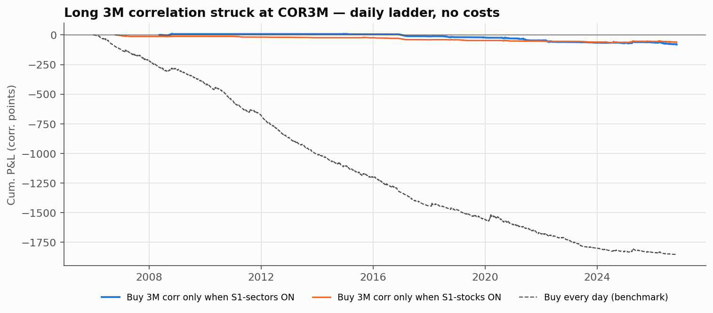

# Trade Idea #01 — Conditional Long Correlation (short S&P 500 dispersion)

*Jonathan Phung · data as of 2026-11-04 · every figure generated by [`long_correlation_trade_idea.ipynb`](long_correlation_trade_idea.ipynb), none typed by hand · not investment advice*

> **Rule status on 2026-11-04: SIGNAL ON — S1-sectors conditions met today** (S1-stocks: ON · S0 high VIX: OFF)
>
> **Does 25+ years of data back the thesis? NOT SUPPORTED on 2001–2026: after S1-sectors days a ≥10% sell-off within 3M was 1.36× as frequent as on a random day (below the 1.5× threshold set in advance); buying S&P 500 variance at the VIX lost less than on a random day (-1.45 vs -2.11 vol pts per trade). The signal is best read as a cheaper moment to buy crash insurance, not as a crisis forecast.**

**Bottom line (S1-sectors vs a random day, same period):**
* S&P 500 falls of 10% or more within 3M: 22% vs 16% (1.36×; threshold fixed in advance: 1.5×).
* Correlation spikes of +15 pts within 3M: 22% vs 12%.
* Average P&L per trade of buying 3M correlation at COR3M: -7.3 vs -22.5 corr pts. Buying 1M variance at the VIX: -1.45 vs -2.11 vol pts.
* Naive high-VIX rule (S0), for comparison: correlation spikes 3% vs 6%, variance P&L -3.41 vs -2.56 vol pts.

## 1. Thesis
Sometimes single stocks move a lot while the index stays calm, because they move in different directions. Dispersion is then extreme and correlation is low. My view is that this state does not last: when a macro shock hits, everything falls together and correlation spikes. Buying correlation in that state means buying crash insurance while it is cheap. The trade is short dispersion: long index vol, short single-stock vol.

The idea is tested as a rule fixed in advance, not by picking crisis dates. The rule uses only data available on each date, counts false alarms, and compares each signal with a random day of the same period and with a naive "high VIX" rule.

## 2. The signal
* **S1-sectors (primary, since 2001-01-22):** the 1M gap between average sector vol and basket vol, for the 9 original sector SPDR ETFs, is above the 80th percentile of its own history, **and** 1M sector correlation is below the 33rd percentile. These are the same 9 investable ETFs since 1998, so there is no survivorship bias.
* **S1-stocks (robustness, since 2006-09-18):** the same rule on today's top-50 S&P 500 stocks. This matches the COR3M basket but applies today's names to the past.
* **S0 (naive benchmark, since 1991-12-30):** VIX is above the 80th percentile of its own history.
* **Today:**
  * Sector dispersion is 13.5 vol pts (percentile 99%), with sector correlation of 3.3 (percentile 0%).
  * Stock dispersion is 24.9 vol pts (percentile 96%), with stock correlation of 6.1 over 1M and 5.6 over 3M.
  * COR3M is 12.2 (percentile 3% since 2006-01-03). VIX is 16.6 (percentile 44%) and VIX3M is 18.8.

## 3. Evidence: what happened next, vs a random day of the same period
| Signal | Days ON | Episodes | P(S&P 500 −10% within 3M): signal vs base | P(corr +15 pts): signal vs base | Avg P&L buying 1M variance at VIX (vol pts): signal vs base |
|---|---|---|---|---|---|
| **S1-sectors** | 680 | 30 | **22% vs 16%** (1.36×) | 22% vs 12% | -1.45 vs -2.11 |
| S1-stocks | 408 | 33 | 14% vs 15% (0.90×) | 15% vs 11% | -1.30 vs -1.77 |
| S0 high VIX | 2035 | 44 | 19% vs 14% (1.37×) | 3% vs 6% | -3.41 vs -2.56 |

There were 30 S1-sectors episodes. 7 were followed by a sell-off of at least 10% within 3M, and 22 were false alarms, with neither a sell-off nor a correlation spike.

**Reference crises** (descriptive only; not used to build the rule):

| Crisis (S&P 500 peak) | S1-sectors days ON (63d before) | S1-stocks | S0 high VIX | Sector corr 1M at peak → max next 3M | S&P 500 worst DD next 3M |
|---|---|---|---|---|---|
| Dot-com 2000 (2000-03-24) | n/a | n/a | 33 | 48.5 → 49.8 | -11.2% |
| GFC 2007 (2007-10-09) | 0 | 0 | 21 | 73.1 → 76.1 | -11.2% |
| COVID 2020 (2020-02-19) | 8 | 0 | 0 | 57.1 → 93.8 | -33.9% |
| Inflation & rates 2022 (2022-01-03) | 8 | 14 | 6 | 50.5 → 52.4 | -13.0% |
| Yen carry 2024 (2024-07-16) | 15 | 41 | 0 | 20.5 → 69.6 | -8.5% |
| Tariffs 2025 (2025-02-19) | 40 | 24 | 1 | 22.2 → 87.4 | -18.9% |

## 4. Backtests (daily ladders, approximate mark-to-market, no costs)
**A. Long 1M S&P 500 variance at the VIX, over 25.7 years.** This is the crash-payoff leg of the trade.

| Strategy | From | Years | Total P&L (vol pts) | P&L/yr | Max drawdown | Time in market |
|---|---|---|---|---|---|---|
| S1-sectors ON | 2001-01-24 | 25.7 | -55.1 | -2.14 | -88.8 | 11% |
| S1-stocks ON | 2006-10-23 | 20.0 | -35.6 | -1.78 | -48.6 | 9% |
| S0 high VIX ON | 1994-04-05 | 32.5 | -334.9 | -10.29 | -334.9 | 25% |
| Every day (benchmark) | 2001-01-22 | 25.7 | -657.5 | -25.55 | -662.7 | 100% |

| Window | S1-sectors (vol pts) | S0 high VIX | Every day |
|---|---|---|---|
| Dot-com bust (2000–02) | n/a | -33.9 | n/a |
| 9/11 (Sep 2001) | 0.0 | 4.6 | 10.1 |
| GFC (Oct 2007–Mar 2009) | 32.6 | 41.8 | 70.0 |
| US downgrade (Jul–Oct 2011) | 0.0 | -0.4 | 34.5 |
| China deval. (Aug 2015) | 0.0 | -0.2 | 28.6 |
| Volmageddon (Feb 2018) | 0.0 | 0.6 | 32.1 |
| Q4 2018 | 4.6 | 1.0 | 21.6 |
| COVID (Feb–Mar 2020) | 0.0 | 47.8 | 155.0 |
| 2022 bear market | 1.9 | -15.3 | -6.7 |
| Yen carry unwind (Jul–Aug 2024) | 24.4 | 0.0 | 24.8 |
| Tariff shock (Feb–Apr 2025) | 7.5 | 3.1 | 38.5 |

**B. Long 3M correlation at COR3M, since 2006-01-03** (COR3M history only).

| Strategy | From | Years | Total P&L (corr pts) | P&L/yr | Max drawdown | Time in market |
|---|---|---|---|---|---|---|
| S1-sectors ON | 2008-05-16 | 18.4 | -80.1 | -4.35 | -89.5 | 16% |
| S1-stocks ON | 2006-10-23 | 20.0 | -60.6 | -3.03 | -66.8 | 9% |
| Every day (benchmark) | 2006-01-03 | 20.8 | -1854.2 | -89.14 | -1854.5 | 100% |

| Strike paid (S1-sectors entries) | Total P&L (corr pts) | P&L/yr | Max DD |
|---|---|---|---|
| COR3M + 0 pts | -80.1 | -4.35 | -89.5 |
| COR3M + 3 pts | -114.9 | -6.23 | -121.9 |
| COR3M + 5 pts | -138.1 | -7.49 | -143.5 |
| COR3M + 8 pts | -172.9 | -9.38 | -175.9 |

## 5. Structure and sizing
* **Long** 3M SPX ATM straddles (or an SPX variance swap). **Short** 3M ATM straddles on the 25 largest names (52% of index weight), allocated by index weight. Same maturity on both legs. Delta-hedge daily.
* **Sizing: proportional vega-neutral (equivalently theta-neutral).** Total component vega = σ_index / Σwᵢσᵢ × index vega = **0.43 × index vega**. Derivation and worked examples: [`notes/vega_neutral_sizing.md`](notes/vega_neutral_sizing.md). Today's snapshot: SPX 3M ATM vol 14.2%, average top-50 3M ATM vol 34.3%, implied correlation (own calculation) 12.3.

**Why this ratio: proportional vega-neutral = theta-neutral**
1. For an ATM option, theta ≈ − vega × σ / (2T). With the same maturity on both legs, the 2T cancels, so the book is **theta-neutral** when Σ vegaᵢ × σᵢ = vega_index × σ_index.
2. In a **proportional** shock, every vol rises by the same x% (15% → 16.5%, 30% → 33% for x = 10%). Each leg moves by vega × x × σ, so the book moves by x × (Σ vegaᵢσᵢ − vega_index σ_index). The theta-neutral condition sets this bracket to zero: **the book is flat for any proportional shock**.
3. A proportional shock leaves the ratio σ_index / Σwᵢσᵢ unchanged, and implied correlation ≈ (that ratio)². So the book is flat exactly when **correlation does not move**, and it gains only when correlation rises.
4. Illustration (fictitious levels: index 15%, stocks 30%, index vega $100k per vol point, stock vega $50k):

| Shock | Index leg (long) | Stock leg (short) | Book |
|---|---|---|---|
| All vols +10% (correlation unchanged) | +1.5 pts → +$150k | +3 pts → −$150k | **0** |
| All vols +1 point (equal-point shock) | +$100k | −$50k | +$50k: residual long vega in points |
| Crash: index 15 → 20, stocks 30 → 33 (correlation ≈ 0.25 → 0.37) | +$500k | −$150k | **+$350k** |

5. **The alternative, vega-neutral in points** (Σ vegaᵢ = vega_index), is flat to equal-point shocks instead. It cannot be theta-neutral at the same time, because stock vols are above index vol whenever correlation is below 1, and it adds a bet on the level of volatility.
6. **Correlation sensitivity:** per $100k of index vega, a 1-point rise in implied correlation gains ≈ **$35,664** (first order).
7. **Limits:** the neutrality holds at inception only. It needs ATM options of the same maturity, and it is first-order: vegas drift as spot and vols move (vanna, volga), so large moves break it.

* **Carry:** ≈ -6.5 correlation pts per 3M at today's levels (negative = the insurance premium).
* **Cleaner alternative:** SPX put spreads or VIX calls, which have the same crash payoff without gap risk on short single-stock options.

## 6. Risks and exit
* **Risks:**
  1. No crisis arrives, so you pay carry and absorb false alarms.
  2. Gaps on the short single-stock legs (earnings, news): avoid names reporting during the option's life.
  3. Single-stock vol rises without correlation rising.
  4. Correlation spikes revert fast, so the gain is lost if not monetized.
* **Take profit:** when COR3M reaches its historical 80th percentile (54.8), or when the VIX curve inverts and then normalizes.
* **Time stop:** hold to the 3M expiry and do not roll unless S1 is still ON.
* **Invalidation:** dispersion returns below its median without correlation rising.

## 7. Limitations
* **Small sample:** few independent episodes, so the percentages are indicative rather than statistically significant.
* **Sector correlation:** the long-history signal uses sector correlation, which is not single-stock correlation.
* **Backtest A:** it covers only the long-index-vol leg, and treats VIX² as the variance strike with no convexity adjustment.
* **Backtest B:** it uses COR3M as the strike, but COR3M is not an executable price, and it covers only the COR3M sample.
* **Not modelled anywhere:** short single-stock gamma and transaction costs.

## 8. Conclusion
**1. Forecasting power.** After S1-sectors days, the S&P 500 fell 10% or more within 3M in 22% of cases, against 16% on a random day (1.36×, versus the 1.5× bar fixed in advance). 7 of 30 episodes were followed by such a sell-off and 22 were false alarms. The signal is not a reliable crash forecaster.

**2. Cost of the insurance.** Buying 3M correlation at COR3M after the signal lost 7.3 pts per trade on average, against 22.5 on a random day: about 3.1× cheaper, but still a cost. Correlation spikes of +15 pts followed 22% of signal days, against 12% of random days.

**3. The naive rule.** After high-VIX days, correlation spikes followed 3% of days (random day: 6%) and buying variance at the VIX returned -3.41 vol pts per trade (random day: -2.56). High volatility arrives with the crisis, when insurance is already expensive: it is the wrong moment to buy correlation.

**4. Today (2026-11-04).** Rule status: SIGNAL ON — S1-sectors conditions met today. Sector dispersion is at percentile 99% of its history, sector correlation at percentile 0%, COR3M at 12.2 (percentile 3%). Carry of a long-correlation position: about -6.5 correlation pts per 3M if nothing happens.

**5. Recommendation.** Present the idea as an **opportunistic hedge, not a forecast**: correlation is cheapest when S1 is ON, so this is the moment to buy a small amount of crash insurance whose cost is known in advance. Size it on the carry budget. SPX put spreads or VIX calls give the same crash payoff without the gap risk of short single-stock options.
