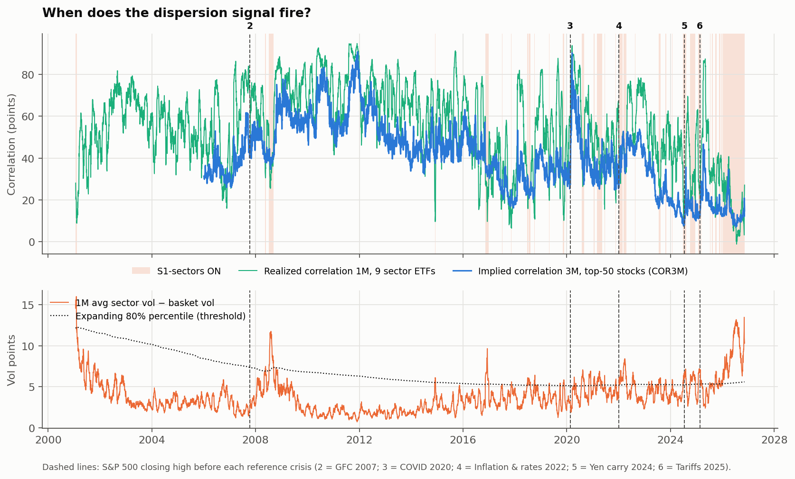
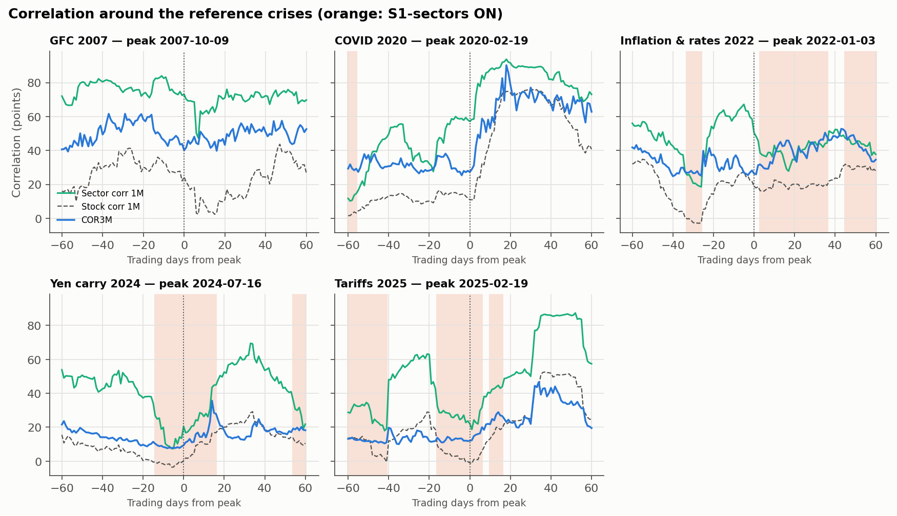
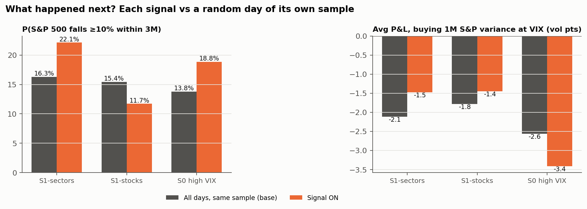
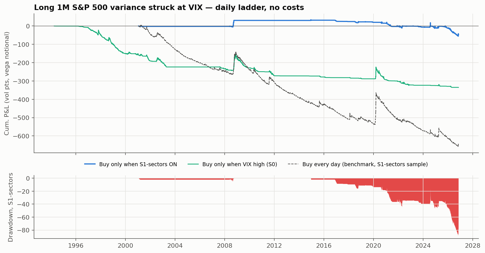

# Trade Idea #01 — Conditional Long Correlation (short S&P 500 dispersion)

*Jonathan Phung · data as of {{SIG_DATE}} · every figure generated by [`long_correlation_trade_idea.ipynb`](long_correlation_trade_idea.ipynb), none typed by hand · not investment advice*

> **Status: work in progress.** First results are published below. Next steps:
> * run a robustness grid over the thresholds, horizons and crisis definition;
> * test two pre-specified macro filters (rates shock, credit spreads);

> **Rule status on {{SIG_DATE}}: {{VERDICT}}** (S1-stocks: {{S1_NOW}} · S0 high VIX: {{S0_NOW}})
>
> **Does 25+ years of data back the thesis? {{THESIS_VERDICT}}**

**Bottom line (S1-sectors vs a random day, same period):**
* S&P 500 falls of 10% or more within 3M: {{S1S_PC}} vs {{S1S_PCB}} ({{S1S_LIFT}}×; threshold fixed in advance: {{LIFT_THR}}×; 95% interval {{S1S_LIFT_LO}}× to {{S1S_LIFT_HI}}×, power {{S1S_POWER}}).
* Correlation spikes of +{{CORR_SPIKE}} pts within 3M: {{S1S_PS}} vs {{S1S_PSB}}.
* Sell-offs counted only from days within 5% of the 1-year high: {{S1S_ONSET_PC}} vs {{S1S_ONSET_PCB}}.
* Average P&L per trade of buying 3M correlation at COR3M, point-in-time basket: {{X_CP}} vs {{X_CPB}} corr pts ({{X_CPM}} on days with the same COR3M level; signal minus base, 95% interval {{X_LO}} to {{X_HI}}). With today's names applied to the past: {{S1S_CP}} vs {{S1S_CPB}}, a survivorship artefact.
* Buying 1M variance at the VIX: {{S1S_VP}} vs {{S1S_VPB}} vol pts ({{S1S_VPM}} at the same VIX level; 95% interval of the gap {{S1S_VP_LO}} to {{S1S_VP_HI}}).
* Naive high-VIX rule (S0), for comparison: correlation spikes {{S0_PS}} vs {{S0_PSB}}, variance P&L {{S0_VP}} vs {{S0_VPB}} vol pts.

## 1. Thesis
Sometimes single stocks move a lot while the index stays calm, because they move in different directions. Dispersion is then extreme and correlation is low. My view is that this state does not last: when a macro shock hits, everything falls together and correlation spikes. Buying correlation in that state means buying crash insurance while it is cheap. The trade is short dispersion: long index vol, short single-stock vol.

The idea is tested as a rule fixed in advance, not by picking crisis dates. The rule uses only data available on each date, counts false alarms, and compares each signal with a random day of the same period and with a naive "high VIX" rule.

## 2. The signal
* **S1-sectors (primary, since {{S1S_START}}):** the 1M gap between average sector vol and basket vol, for the 9 original sector SPDR ETFs, is above the {{DISP_THR}} of its own history, **and** 1M sector correlation is below the {{CORR_THR}}. These are the same 9 investable ETFs since 1998, so there is no survivorship bias; their content did change (real estate left XLF, communication names left XLK and XLY).
* **S1-stocks (robustness, since {{S1_START}}):** the same rule on today's top-{{N}} S&P 500 stocks. This matches the COR3M basket but applies today's names to the past.
* **S1-stocks, point-in-time (since {{S1P_START}}, to {{PIT_END}}):** the same rule on the 50 largest US companies *of each day* (CRSP), with the basket frozen on the entry day to measure what follows. This removes the survivorship bias of the line above.
* **S0 (naive benchmark, since {{S0_START}}):** VIX is above the {{VOL_THR}} of its own history.
* **Today:**
  * Sector dispersion is {{DISP_S_NOW}} vol pts (percentile {{P_DISP_S}}), with sector correlation of {{RCS_1M}} (percentile {{P_CORR_S}}).
  * Stock dispersion is {{DISP_NOW}} vol pts (percentile {{P_DISP}}), with stock correlation of {{RC_1M}} over 1M and {{RC_3M}} over 3M (index-based; {{RC_3M_B}} over 3M measured on the basket itself).
  * COR3M is {{COR3M}} (percentile {{COR3M_PCTL}} since {{COR3M_SINCE}}). VIX is {{VIX}} (percentile {{P_VOL}}) and VIX3M is {{VIX3M}}.

## 3. Evidence: what happened next, vs a random day of the same period
| Signal | Days ON | Episodes | P(S&P 500 −{{CRISIS_DD}} within 3M): signal vs base | P(corr +{{CORR_SPIKE}} pts): signal vs base | Avg P&L buying 1M variance at VIX (vol pts): signal vs base |
|---|---|---|---|---|---|
| **S1-sectors** | {{S1S_DAYS}} | {{S1S_EP}} | **{{S1S_PC}} vs {{S1S_PCB}}** ({{S1S_LIFT}}×) | {{S1S_PS}} vs {{S1S_PSB}} | {{S1S_VP}} vs {{S1S_VPB}} |
| S1-stocks | {{S1_DAYS}} | {{S1_EP}} | {{S1_PC}} vs {{S1_PCB}} ({{S1_LIFT}}×) | {{S1_PS}} vs {{S1_PSB}} | {{S1_VP}} vs {{S1_VPB}} |
| S1-stocks, point-in-time | {{S1P_DAYS}} | {{S1P_EP}} | {{S1P_PC}} vs {{S1P_PCB}} ({{S1P_LIFT}}×) | {{S1P_PS}} vs {{S1P_PSB}} | {{S1P_VP}} vs {{S1P_VPB}} |
| S0 high VIX | {{S0_DAYS}} | {{S0_EP}} | {{S0_PC}} vs {{S0_PCB}} ({{S0_LIFT}}×) | {{S0_PS}} vs {{S0_PSB}} | {{S0_VP}} vs {{S0_VPB}} |

There were {{S1S_EP}} S1-sectors episodes. {{S1S_EP_CRISIS}} were followed by a sell-off of at least {{CRISIS_DD}} within 3M, and {{S1S_EP_FALSE}} were false alarms, with neither a sell-off nor a correlation spike.

**What the point-in-time universe changes.** Over the common sample, 3M realized correlation averages {{PIT_RC}} with the names of each day against {{TODAY_RC}} with today's names applied to the past, so COR3M minus trailing realized correlation is {{PIT_PREM}} pts instead of {{TODAY_PREM}}. Buying 3M correlation at COR3M then returns {{S1P_CP}} pts per trade after the signal against {{S1P_CPB}} on a random day ({{S1P_CPM}} on days with the same COR3M level).

**Reference crises** (descriptive only; not used to build the rule). A signal that was ON before the peak only helps if the trade bought then was still alive and paid: the P&L column shows what those entries earned.

{{REF_TABLE}}

**How reliable is this?** Daily outcomes overlap, so the honest sample is the number of episodes. The table adds an episode-level test, a comparison with days at the same level of VIX / COR3M / realized correlation (low correlation mean-reverts and is cheap whatever the signal says), a time-shift test and a block bootstrap.

{{INF_TABLE}}

## 4. Backtests (daily ladders, approximate mark-to-market, no costs)
**A. Long 1M S&P 500 variance at the VIX, over {{VAR_BT_YEARS}} years.** This is the crash-payoff leg of the trade.

{{VAR_TABLE}}

{{STRESS_TABLE}}

**B. Long 3M correlation at COR3M, since {{COR3M_BT_START}}** (COR3M history only).

{{CORR_TABLE}}

{{MARKUP_TABLE}}

{{FIG5}}

## 5. Structure
* **Long** 3M SPX ATM straddles (or an SPX variance swap). **Short** 3M ATM straddles on the {{TRADE_N}} largest names ({{TRADE_IDX_WEIGHT}} of index weight). Delta-hedge daily.
* **Theta-neutral:** component vega = **{{VEGA_RATIO}} × index vega**. Per $100k of index vega, a 1-point rise in implied correlation gains ≈ **${{CORR_VEGA_100K}}**.
* Today's snapshot: SPX 3M ATM vol {{IDX_IV_3M}}, average top-{{N}} 3M ATM vol {{COMP_IV_3M}}, implied correlation (own calculation) {{IC_3M}}.
* **Carry:** ≈ {{CARRY_3M}} correlation pts per 3M at today's levels (negative = the insurance premium).
* **Cleaner alternative:** SPX put spreads or VIX calls, which have the same crash payoff without gap risk on short single-stock options.

## 6. Risks and exit
* **Risks:**
  1. No crisis arrives, so you pay carry and absorb false alarms.
  2. Gaps on the short single-stock legs (earnings, news): avoid names reporting during the option's life.
  3. Single-stock vol rises without correlation rising.
  4. Correlation spikes revert fast, so the gain is lost if not monetized.
* **Take profit:** when COR3M reaches its historical 80th percentile ({{TP_COR3M}}), or when the VIX curve inverts and then normalizes.
* **Time stop:** hold to the 3M expiry and do not roll unless S1 is still ON.
* **Invalidation:** dispersion returns below its median without correlation rising.

## 7. Limitations
* **Small sample:** few independent episodes, so the percentages are indicative rather than statistically significant.
* **Sector correlation:** the long-history signal uses sector correlation, which is not single-stock correlation.
* **Backtest A:** it covers only the long-index-vol leg, and treats VIX² as the variance strike with no convexity adjustment.
* **Backtest B:** it uses COR3M as the strike, but COR3M is not an executable price, and it covers only the COR3M sample.
* **Not modelled anywhere:** short single-stock gamma and transaction costs.
* **Measure of realized correlation:** index-based (the COR3M convention) and basket-based measures differ by many points and can flip the sign of the correlation P&L. Backtest B and the reference-crisis table still use today's names in the past; the point-in-time rows are the ones to trust.
* **Point-in-time basket:** the 50 largest US companies by CRSP capitalization, not the exact Cboe basket (no float adjustment, no index-membership test); sample ends 2025-12-31.

## 8. Conclusion
{{CONCLUSION}}
